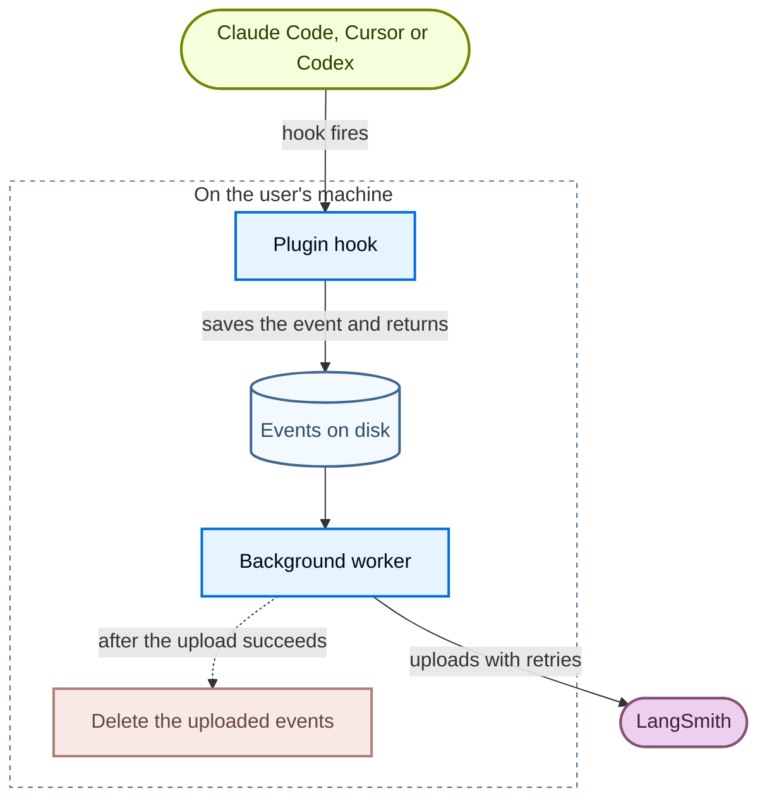
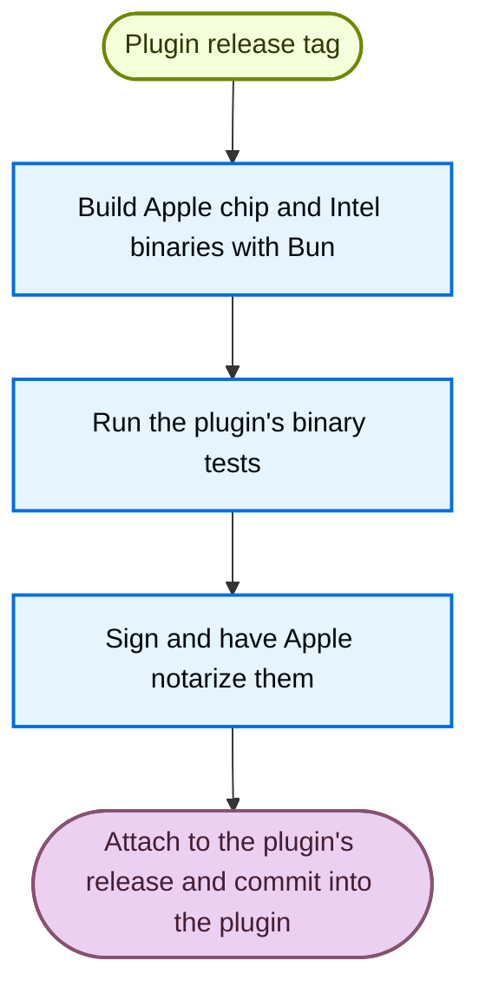

# @langchain/plugins-base

The shared engine behind the LangSmith tracing plugins for Claude Code, Cursor and Codex. It turns each agent's hook events into LangSmith traces and builds each plugin's signed macOS binary.

```sh
pnpm add @langchain/plugins-base
```

## How it works

Each plugin ships the engine inside itself rather than calling a separate service. A hook saves the event to disk and returns right away, then a background worker uploads it so the agent never waits on LangSmith.



- **Plugin** reads its agent's events and transcript, and imports everything else from the engine.
- **Settings** ([src/settings](src/settings)) merges config files, environment variables and an admin's managed file. See the [settings guide](docs/settings.md).
- **Events on disk** ([src/storage](src/storage)) act as the queue, so nothing is lost if the agent exits mid-turn. A turn's files are deleted once it uploads.
- **Background worker** ([src/tracing](src/tracing)) rebuilds the runs, adds git metadata, strips secrets and uploads with retries.
- **Auth** ([src/auth](src/auth)) uses the plugin's own key first, then the `langsmith auth login` sign-in, then a key from the shell.

## Building the plugin binaries

Each plugin calls this repo's reusable `build-binary.yml` workflow pinned to a release tag's commit.



See [ONBOARDING.md](docs/ONBOARDING.md) to set up a new plugin.

## Developing

```sh
pnpm install
pnpm test
pnpm run lint
pnpm run build   # also runs on install, since dist/ is built rather than committed
```
