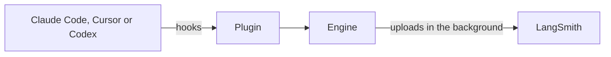

# @langchain/plugins-base

The shared engine behind the LangSmith plugins for Claude Code, Cursor and Codex. It handles each agent's hooks, uploads every turn, tool call and subagent to LangSmith in the background and fills in git metadata once it's known, so all three plugins trace the same way. It also builds and signs each plugin's macOS binary.

```sh
pnpm add @langchain/plugins-base
```

## How it works



The agent never waits on the upload and anything that fails is retried later. The engine is a library each plugin ships inside itself rather than a separate service.

## Building the plugin binaries

Each plugin calls this repo's reusable `build-binary.yml` workflow pinned to a release tag's commit. On a tag it builds Apple chip and Intel binaries, tests and signs them, has Apple notarize them and attaches them to the plugin's release. See [ONBOARDING.md](docs/ONBOARDING.md) to set up a new plugin.

## Developing

```sh
pnpm install
pnpm test
pnpm run lint
pnpm run build   # dist/ is committed, so rebuild it after changes
```
